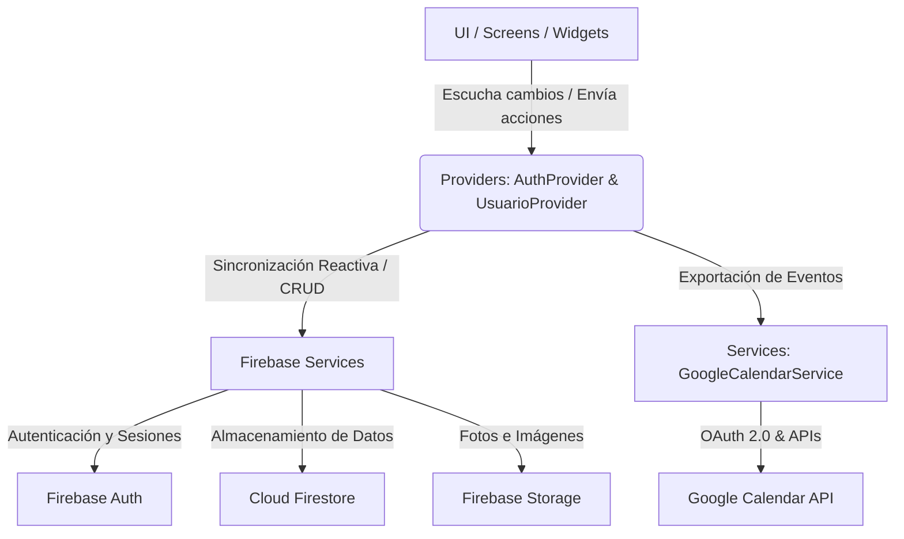

# 🏠 AppHome - Gestor Integral del Hogar y de la Familia

[](https://flutter.dev)
[](https://dart.dev)
[](https://firebase.google.com)
[](https://developers.google.com/calendar)
[](#)

**AppHome** es una aplicación multiplataforma premium desarrollada con **Flutter** y **Firebase** diseñada para centralizar y simplificar la gestión cotidiana de tu hogar y de tu núcleo familiar. A diferencia de las utilidades aisladas, AppHome reúne en un solo ecosistema reactivo y moderno el control de tus finanzas, propiedades, estudios, empleo, citas médicas, vehículos y planificación del día a día, con capacidades avanzadas de **sincronización en la nube** e **integración directa con Google Calendar**.

---

## 🌟 Características Principales

La aplicación se divide en 5 grandes bloques funcionales integrados entre sí de forma reactiva:

### 1. 📅 Inicio y Calendario Unificado
*   **Consolidación de Eventos Inteligente:** Unifica dinámicamente las fechas clave de múltiples módulos en un solo calendario interactivo mensual/quincenal desarrollado con `table_calendar`:
    *   **Salud:** Citas médicas de todos los miembros de la familia.
    *   **Estudios:** Exámenes y eventos escolares de los estudiantes.
    *   **Hogar:** Vencimiento de pólizas de seguros de vivienda.
    *   **Gestión:** Fechas de cobro de suscripciones mensuales y gastos recurrentes.
*   **Sincronización Directa con Google Calendar:** Exporta todos tus eventos consolidados directamente al calendario de tu cuenta de Google mediante integración OAuth de la API de Google en tiempo real.
*   **Accesos Directos:** Panel inferior táctil para navegar rápidamente a las secciones críticas.

### 2. 👥 Gestión Familiar (Miembros del Hogar)
*   **Miembros Compartidos:** Registro completo de personas con fotos de perfil dinámicas (almacenadas en Firebase Storage) e información esencial (DNI, Dirección, Teléfono, Grupo Sanguíneo).
*   **Perfiles Laborales y Académicos:** Asocia roles específicos a cada miembro:
    *   **🎓 Educación:** Seguimiento escolar completo que incluye asignaturas, calificaciones, tareas escolares, eventos académicos, diplomas/títulos y control de tasas/pagos escolares.
    *   **💼 Empleo:** Datos del puesto, empresa, contratos laborales y un **historial de nóminas interactivo** que muestra un gráfico analítico de ingresos acumulados en los últimos 12 meses.
*   **Salud Familiar:** Historial clínico centralizado por miembro con control de alergias, número de seguridad social, citas médicas programadas, tratamientos activos, vacunas administradas, pruebas diagnósticas y alertas médicas.
*   **📇 Documentos e Información Física:** Gestión de tallas de ropa de cada miembro y almacenamiento/registro de documentos de identidad oficiales.

### 3. 🏡 Control Patrimonial e Inmuebles
*   **Registro de Viviendas:** Gestión de múltiples propiedades con alias, dirección, referencia catastral e impuestos como el IBI.
*   **Inversión Patrimonial Global:** Gráfico dinámico comparativo de los costes totales incurridos en **Reformas** frente a las primas anuales de **Seguros de Hogar**.
*   **Inventario y Habitaciones:**
    *   Diseño y distribución de habitaciones por propiedad.
    *   Inventario digital detallado de electrodomésticos y enseres asociados, incluyendo marca, modelo, número de serie y observaciones.
*   **Seguros e Historial:** Registro detallado de la póliza de seguro asociada al inmueble e historial cronológico de reformas realizadas.

### 4. 🛒 Gestión Doméstica Cotidiana
*   **Menú Semanal:** Planificador de comidas de Lunes a Domingo dividido en desayuno, almuerzo y cena.
*   **Lista de la Compra:** Lista reactiva e interactiva de artículos con check instantáneo que muestra los ítems pendientes en el panel de resumen.
*   **Gastos y Suscripciones:** Registro de servicios contratados (Netflix, Spotify, etc.) con cálculo automático del total de costes mensuales y avisos de cobro en el calendario.
*   **Servicios y Suministros:** Fichas informativas y de control de los suministros activos (Luz, Agua, Internet, Gas, etc.) con sus correspondientes datos de proveedor y contratos.

### 5. 🚗 Control de Flota de Vehículos
*   **Gestión Multitarea de Vehículos:** Visualización mediante tarjetas detalladas de tu flota de coches y motos.
*   **Ficha Técnica Avanzada:** Vista dividida en 7 pestañas de control especializado para cada vehículo:
    1.  **Info:** Matrícula, bastidor, combustible, kilometraje actual.
    2.  **Mantenimiento:** Registro cronológico de visitas al taller con cálculo de gastos acumulados.
    3.  **ITV:** Historial de inspecciones pasadas y alertas de próxima fecha límite.
    4.  **Impuestos:** Control del impuesto de circulación pagado y pendiente.
    5.  **Seguro:** Datos de la aseguradora, número de póliza, contacto de asistencia en carretera y primas.
    6.  **Multas:** Listado y estado de infracciones de tráfico asociadas.
    7.  **Accidentes:** Historial de partes de siniestros y resoluciones.

---

## 🛠️ Arquitectura y Stack Tecnológico

El proyecto sigue las mejores prácticas de desarrollo en Flutter, estructurado bajo un patrón modular robusto y reactivo:



### Tecnologías Clave Utilizadas:
*   **Flutter (SDK ^3.11.3):** Desarrollo de interfaz responsiva multiplataforma con soporte para Android, iOS, Windows y Web.
*   **State Management (Provider ^6.1.5):** Uso de `ChangeNotifierProvider` y `ChangeNotifierProxyProvider` para gestionar y enlazar reactivamente la autenticación del usuario con la sincronización y carga de su base de datos.
*   **Cloud Firestore:** Base de datos NoSQL en tiempo real, configurada con **caché persistente ilimitada** para garantizar el correcto funcionamiento offline de la aplicación y la sincronización automática una vez se recupere la conexión a Internet.
*   **Firebase Auth:** Inicio de sesión y registro de cuentas mediante Email/Contraseña y proveedor OAuth de **Google Sign-In**.
*   **Google Calendar API (`googleapis` & `googleapis_auth`):** Acceso seguro mediante tokens OAuth dinámicos para insertar eventos de la app en la cuenta personal del usuario.
*   **Google Fonts (Inter):** Sistema tipográfico moderno y premium para mejorar la lectura y estética general de la interfaz.

---

## 📂 Estructura de Directorios

El código está organizado de manera que los componentes estén desacoplados, facilitando el mantenimiento y la escalabilidad del proyecto:

```
lib/
├── main.dart                      # Inicialización de servicios (Firebase, locales) y enrutador principal
├── pruebas.dart                   # Script de desarrollo para pruebas rápidas
├── models/                        # Modelos de datos estructurados
│   ├── common/                    # Eventos del calendario unificado
│   ├── educacion/                 # Calificaciones, eventos escolares, asignaturas, títulos
│   ├── gestion/                   # Lista de compras, suministros, suscripciones, menús
│   ├── hogar/                     # Propiedades, electrodomésticos, reformas, seguros de hogar
│   ├── salud/                     # Citas médicas, vacunas, tratamientos, historial clínico
│   ├── trabajo/                   # Nóminas, contratos laborales, detalles de empleo
│   └── usuarios/                  # Persona, tallas, documentos de identidad
├── providers/                     # Gestores de estado de la aplicación
│   ├── auth_provider.dart         # Control del inicio de sesión (Email, Google, Invitado) y tokens
│   └── usuario_provider.dart      # Streams en tiempo real con Firestore y consolidación de eventos
├── services/                      # Servicios y conectores de APIs externas
│   ├── google_calendar_service.dart # Conexión a la API de Google Calendar y mapeo de eventos
│   └── storage_service.dart       # Gestión de subida y borrado de imágenes en Firebase Storage
└── ui/                            # Capa de interfaz de usuario
    ├── screens/                   # Pantallas principales (Inicio, Miembros, Inmuebles, Gestión, etc.)
    │   ├── auth/                  # Inicio de sesión y registro estilo Neumorfismo / Dark Mode
    │   └── ...                    # Más de 70 pantallas para adiciones y edición de información detallada
    ├── theme/                     # Sistema de diseño y colores centralizado (AppTheme)
    └── widgets/                   # Widgets y componentes especializados reutilizables (vehículos, etc.)
```

---

## 🗄️ Esquema de la Base de Datos (Cloud Firestore)

La aplicación utiliza una arquitectura multiusuario compartida. Los datos se organizan en torno al concepto de **Familia Compartida** (`familyId`), lo que permite que varios dispositivos sincronicen la misma información compartiendo una dirección de email vinculada:

```
familias/
  └── [familyId] (basado en el email del usuario principal)
        ├── gestion/
        │     └── datos (Documento único con arrays de: listaCompra, suscripciones, suministros, menuSemanal)
        ├── miembros/
        │     └── [dni] (Un documento por persona con sus datos médicos, escolares, laborales y tallas)
        └── propiedades/
              └── [alias] (Un documento por propiedad con sus habitaciones, electrodomésticos y reformas)
```

> 💡 **Función de Familia Compartida:** Desde el menú de Miembros, cualquier usuario puede vincular su aplicación a la familia de otro miembro ingresando el correo electrónico del usuario principal. La aplicación migrará o se enlazará automáticamente de forma reactiva al instante.

---

## 🚀 Instalación y Configuración Rápida

Para clonar y ejecutar localmente este proyecto en tu entorno de desarrollo, sigue los pasos a continuación:

### Requisitos Previos:
*   [Flutter SDK](https://docs.flutter.dev/get-started/install) (versión >= 3.11.3)
*   [Dart SDK](https://dart.dev/get-started/sdk) (versión compatible con tu instalación de Flutter)
*   Una cuenta activa de Firebase.

### 1. Clonar el repositorio
```bash
git clone https://github.com/tu-usuario/app_home.git
cd app_home
```

### 2. Descargar las dependencias del proyecto
```bash
flutter pub get
```

### 3. Configurar Firebase en el Proyecto

> ⚠️ **Este repositorio no incluye las credenciales de Firebase** (están fuera del control de versiones a propósito). Sin ellas la app arranca, pero muestra un aviso rojo y el login no funciona.

*   Crea un proyecto en la [consola de Firebase](https://console.firebase.google.com/).
*   **Android:** registra una app con el package exacto `com.example.app_home` (definido en `android/app/build.gradle.kts`), descarga `google-services.json` y colócalo en `android/app/`. Si el package no coincide, el build falla.
*   **iOS:** registra la app con el bundle id del proyecto y coloca `GoogleService-Info.plist` en `ios/Runner/`.
*   **Web / Windows / macOS / Linux:** necesitan `lib/firebase_options.dart`, que se genera con la CLI (no se puede escribir a mano sin las claves). Pasos:
```bash
npm install -g firebase-tools
firebase login
dart pub global activate flutterfire_cli
flutterfire configure
```
*   Habilita **Authentication** (Email/Contraseña y Google), **Cloud Firestore** y **Firebase Storage** en la consola.
*   Verifica que `Firebase.initializeApp()` encuentra configuración: si ves el aviso *"Firebase no está configurado"* en la pantalla de login, los archivos siguen faltando o la app no se reinició por completo (el `main()` no se vuelve a ejecutar con *hot reload*).
*   **Nunca subas estos archivos al repositorio.** Deben estar en `.gitignore`:
    *   `android/app/google-services.json`
    *   `ios/Runner/GoogleService-Info.plist`
    *   `lib/firebase_options.dart`


### 4. Habilitar la API de Google Calendar (Para la sincronización)
*   Ve a la [consola de Google Cloud](https://console.cloud.google.com/).
*   Selecciona el proyecto creado por Firebase.
*   Busca la **Google Calendar API** y haz clic en **Habilitar**.
*   Configura la pantalla de consentimiento de OAuth2 y añade las credenciales correspondientes a tu aplicación (claves SHA-1 para el login en Android).

### 5. Compilar y Ejecutar la Aplicación
Conecta tu dispositivo de pruebas (o inicia un emulador) y ejecuta el siguiente comando:
```bash
flutter run
```

---

## 🎨 Paleta de Colores y Estilo Visual
AppHome implementa un sistema de diseño premium oscuro (`AppTheme.dark`) con los siguientes tokens de diseño:
*   **Fondo de Pantalla (`bgDark`):** `#1C1E2E` (Tono azulado oscuro elegante)
*   **Fondo de Superficies (`bgSurface`):** `#252838`
*   **Tarjetas y Bloques (`bgCard`):** `#2A2D42`
*   **Color de Acento (`accent`):** `#6C63FF` (Índigo neón con un gradiente hacia el rosa `#EC4899`)
*   **Fuentes tipográficas:** Uso exclusivo de la familia *Inter* de Google Fonts para una legibilidad óptima y moderna.

---

Desarrollado con ❤️ para facilitar la organización en el hogar. Si encuentras útil este proyecto, ¡no dudes en darle una ⭐ en GitHub!